# Analytics Builder Management

A Cumulocity web plugin (plus an optional microservice) to manage Analytics Builder extensions in the Streaming Analytics application: upload and monitor custom block extensions, or build them online from blocks in GitHub repositories.

## Content
- [Documentation](#documentation)
- [Overview](#overview)
- [Manage custom extensions](#manage-custom-extensions)
- [Sample repositories and building custom extensions](#sample-repositories-and-building-custom-extensions)
- [Monitoring](#monitoring)
- [Installation](#installation)
- [Build the plugin](#build-the-plugin)
- [Backend microservice](#backend-microservice)
- [Analytics Builder block SDK](#analytics-builder-block-sdk)
- [Troubleshooting](#troubleshooting)
- [Repository layout for building extensions](#repository-layout-for-building-extensions)

## Documentation

- [AGENT.md](AGENT.md) - system overview, architecture, how to run
- [CONTRIBUTING.md](CONTRIBUTING.md) - contribution guidelines and development workflow
- [docs/ARCHITECTURE.md](docs/ARCHITECTURE.md) - architecture decision records
- [docs/UI-GUIDE.md](docs/UI-GUIDE.md) and [docs/BACKEND-GUIDE.md](docs/BACKEND-GUIDE.md) - frontend and backend guides
- [analytics-service/API.md](analytics-service/API.md) - backend API
- [docs/MIGRATION-SECURITY-2026-10.md](docs/MIGRATION-SECURITY-2026-10.md) - migration guide for the October 2026 security hardening

Run the tests with `npm test` in `analytics-ui` (frontend) or `pytest` in `analytics-service` (backend).

## Overview

This solution extends the functionality of the standard Cumulocity Streaming Analytics application by incorporating a plugin to manage and add Analytics Builder Blocks as extensions. The current standard user interface lacks the capability to upload custom blocks packaged as **.zip** files. This plugin enhances the Streaming-Analytics UI by introducing these capabilities.

The extension allows you to manage the complete lifecycle of an extension:
* List, upload, download, update and delete Analytics Builder extensions.
* List installed blocks.
* Manage GitHub repositories, which act as a source for dynamically building new extensions.
* Build new extensions from selected blocks and deploy them in the Streaming Analytics engine.
* Monitor alarm status and events sent from the Analytics Builder engine to analyze deployment failures.

Analytics Builder blocks are built using the [Analytics Builder Block SDK](https://github.com/Cumulocity-IoT/apama-analytics-builder-block-sdk). Externally built extensions can be uploaded in the UI.

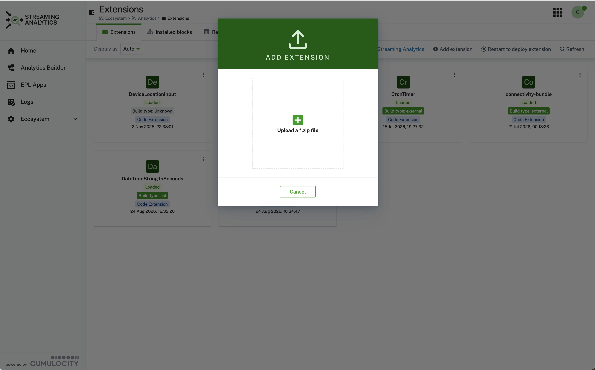

The **Installed blocks** tab lists all installed analytics blocks with their name, category, whether they are custom blocks and the extension package they belong to.

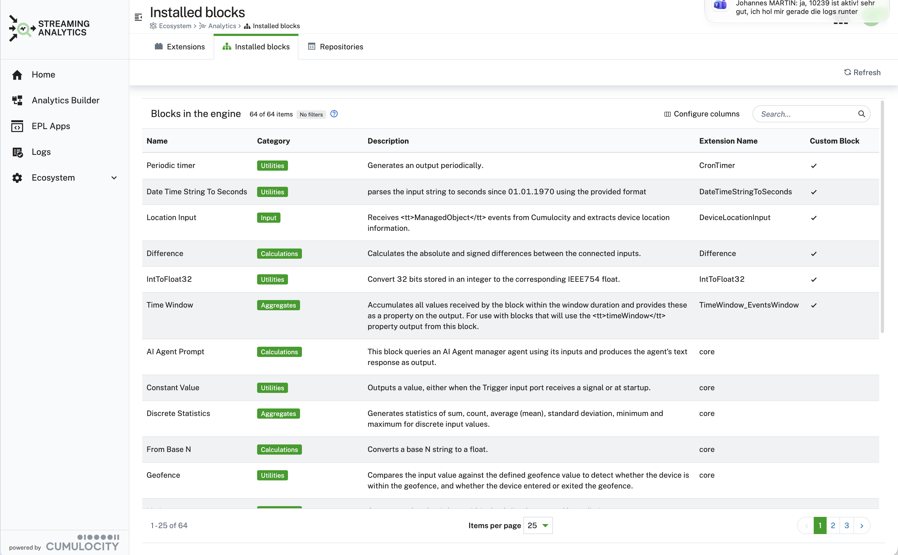

## Manage custom extensions
Custom extensions can be uploaded from your local system, downloaded and deleted. An upload, update or deletion only takes effect after you restart the Streaming Analytics engine.

### Upload custom extension

Upload an externally built extension with the button **Add extension**. Drop the **.zip** file into the dialog; the extension is stored in the repository but not yet deployed. To deploy it, click **Restart to deploy extension** and wait for the notification confirming the engine restart.
If an extension with the same name already exists, you are asked to confirm that it is replaced with the new version, or you can cancel.

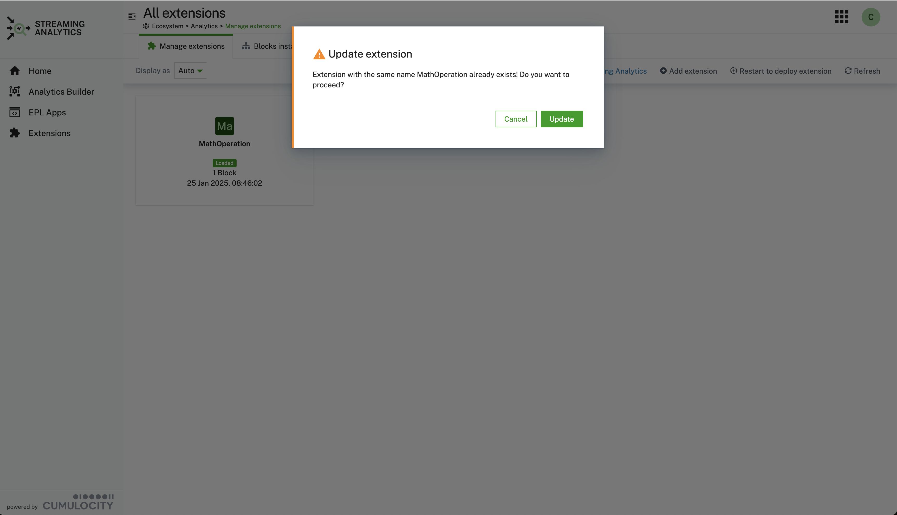

After the restart the blocks are available in the Streaming Analytics application.

### Safe mode

If an extension could not be deployed, the engine may start in [Safe Mode](https://cumulocity.com/docs/streaming-analytics/troubleshooting/#apama_safe_mode), i.e. without loading any extension. A **Safe Mode** indicator then appears in the action bar of the **Extensions** tab, all extensions are shown as *Not loaded*, and the extension that was added or updated last is marked as the **suspected cause**.

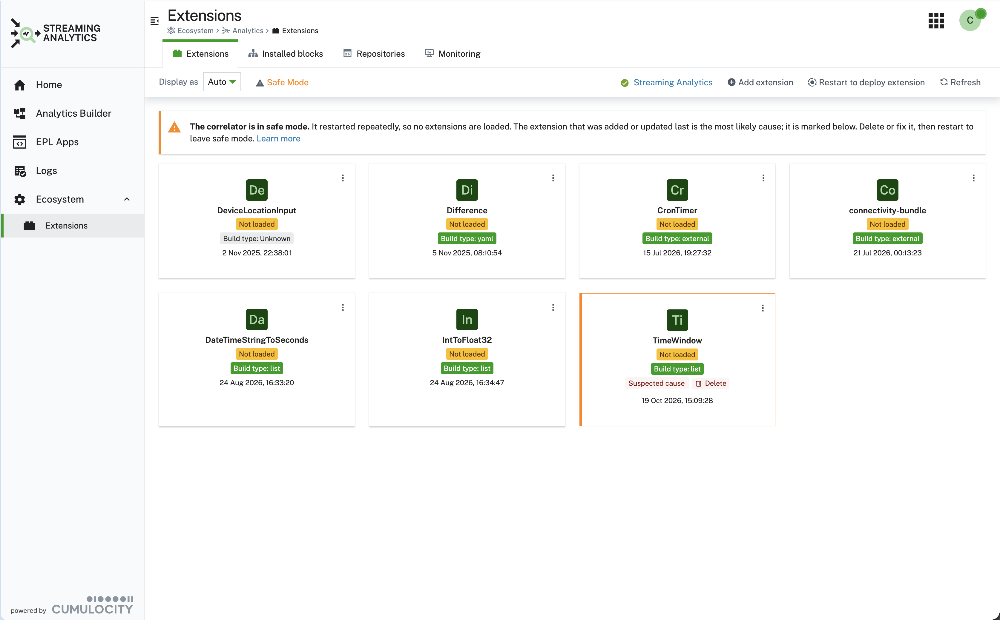

This usually happens when a faulty extension was deployed. Delete (or fix) the suspected extension, then restart the engine. If needed, check the logs of the microservice **apama-ctrl-Xc-Xg**.

Deleting an extension removes its blocks. There is no check whether they are used in existing models, which can make those models undeployable.

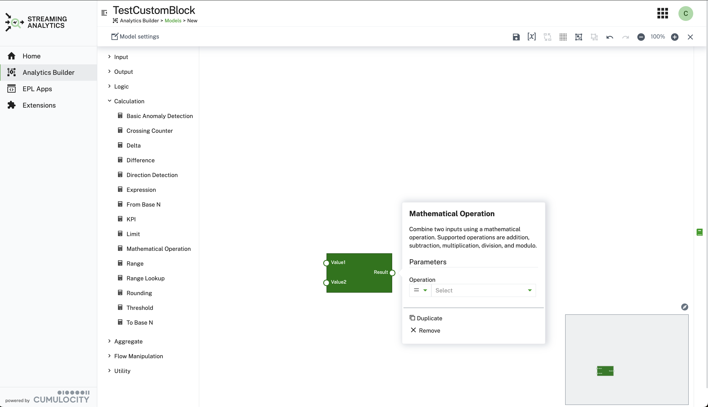

### Options for custom extension
For a custom extension you have the following options:
* Delete: deletes the custom extension permanently. To take effect you need to restart the streaming analytics engine.
* Update: updates the custom extension with a new version of the extension. To take effect you need to restart the streaming analytics engine.
* Details: lists the included blocks of the custom extension on a detail page.
* Download: downloads the custom extension as a zip file.

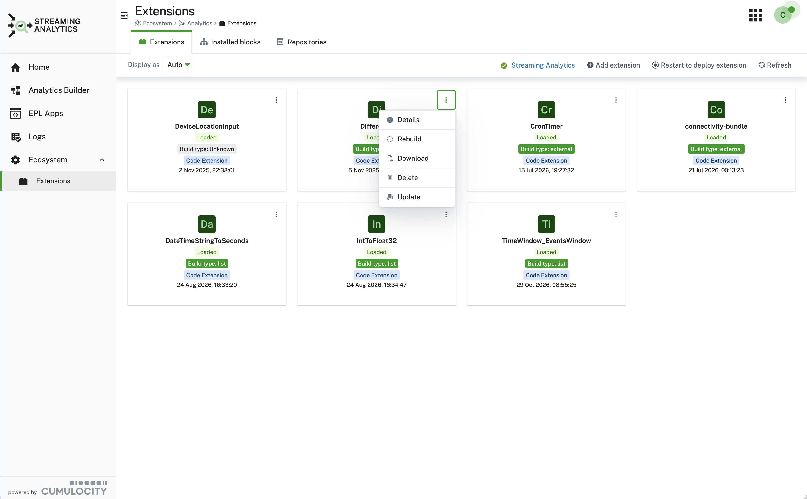

## Sample repositories and building custom extensions
Block samples from GitHub repositories can be selected to build a custom extension online. First configure a GitHub repository on the **Repositories** tab. Configured repositories can be updated, deleted and enabled/disabled; only enabled repositories appear in the list of block samples.

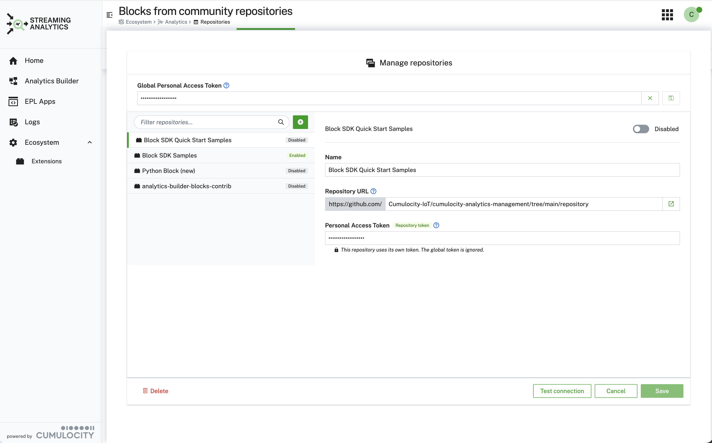

You can also view the EPL (Event Processing Language) source code of a block:

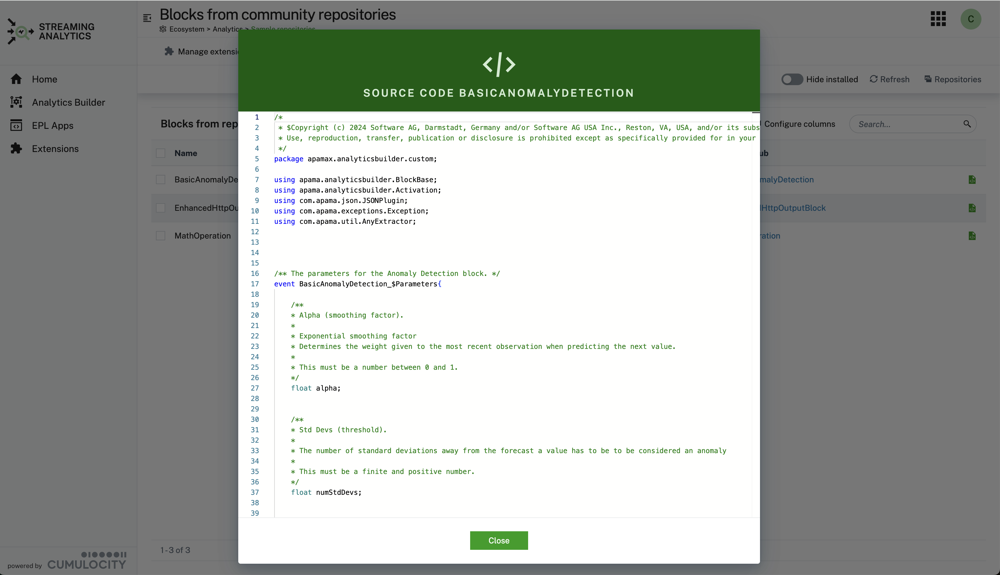

> **Rate limits and private repositories:** unauthenticated GitHub API requests are rate limited and cannot read private repositories; the list then stays empty and a `401` error is shown. Configure a personal access token for the repository to avoid this.
>
> 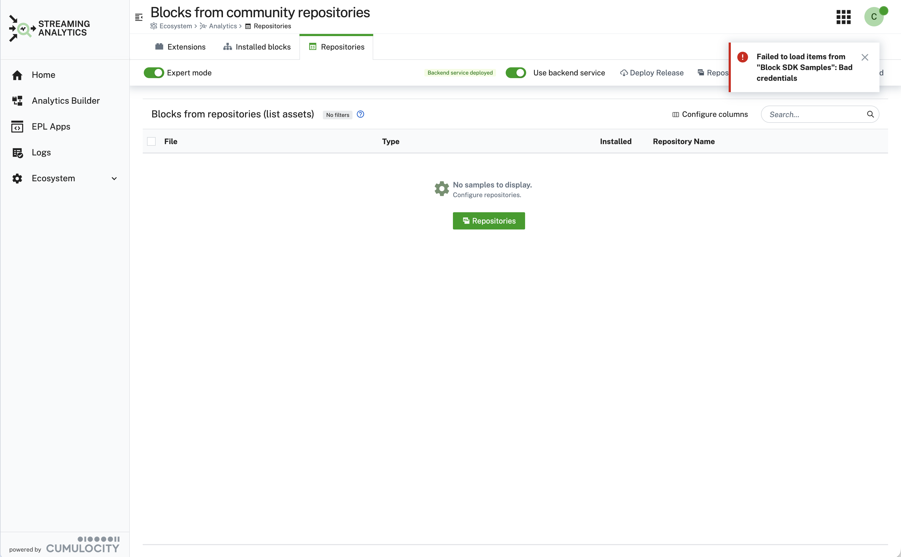
>
> 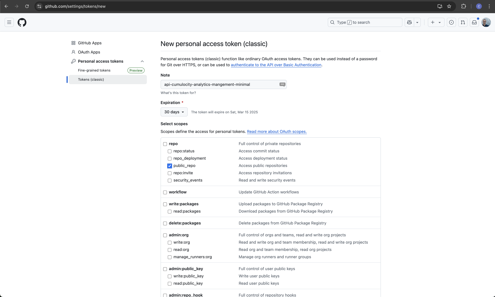

To build an extension, select blocks from the list of samples and click **Custom extension** in the table header. The dialog lets you:
* name the custom extension,
* upload it automatically to the Cumulocity inventory (otherwise it is downloaded to your machine and must be uploaded manually),
* restart the Streaming Analytics engine to load the new extension.

Building requires the [backend microservice](#backend-microservice).

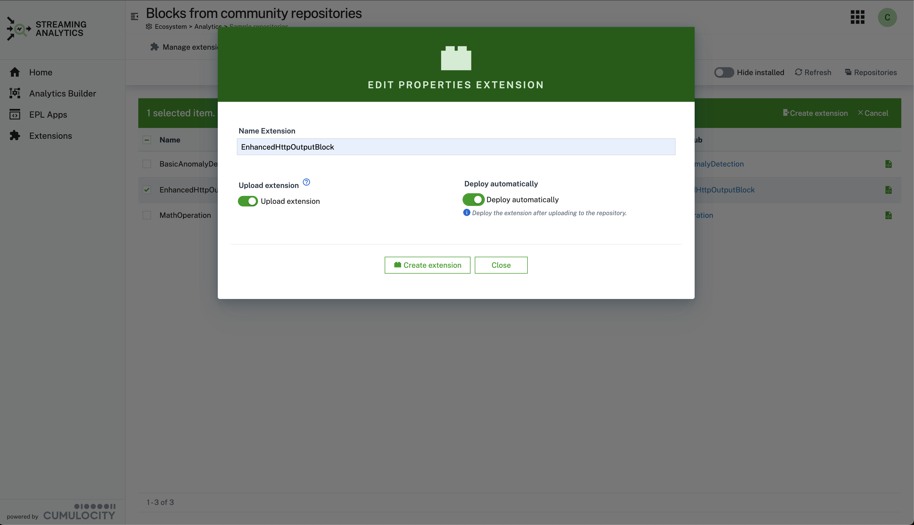

Extensions built with the backend carry build information (build type, source repository), so they can be rebuilt from the same repository.

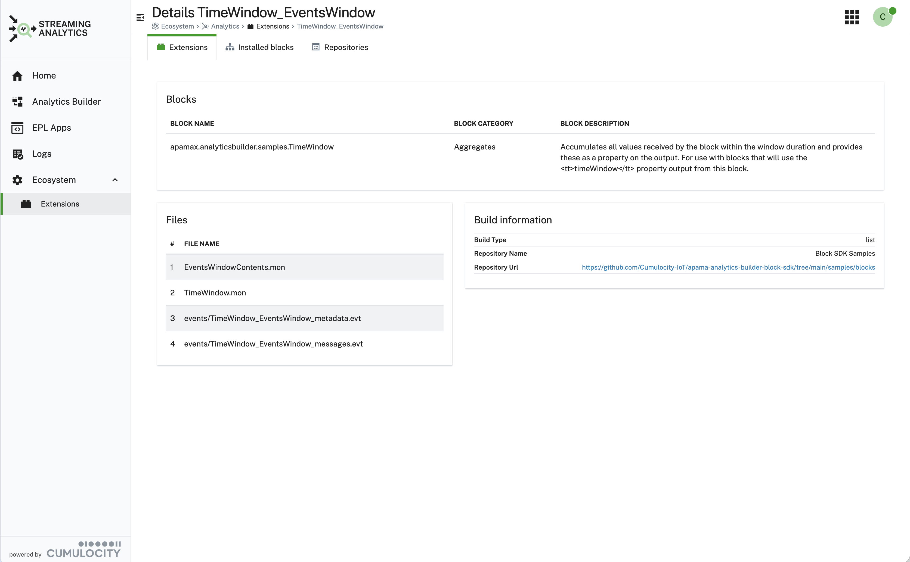

## Monitoring

The **Monitoring** tab shows the engine status and the latest alarms and events of the Streaming Analytics engine. This is especially helpful if no extension is loaded after an upload.

The property `is_safe_mode` indicates that the engine was started in [Safe Mode](https://cumulocity.com/docs/streaming-analytics/troubleshooting/#apama_safe_mode). In this case delete the most recently uploaded extension and restart the engine.

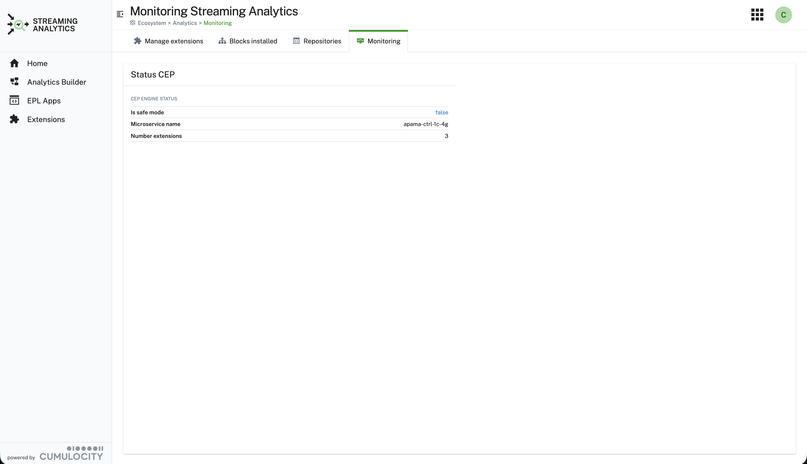

### Backend service switch

The action bar shows whether the backend microservice is deployed. If it is, the **Use backend service** switch (stored as a tenant option, default on) controls whether the plugin uses the backend or works in browser-only mode, in which building extensions is not available. If you deploy or remove the microservice while the page is open, click **Re-check** to refresh the state.

## Installation

The solution consists of two parts:
* **Backend microservice** `analytics-ext-service` (optional, but required to build custom extensions). Download `analytics-ext-service.zip` from the [releases](https://github.com/Cumulocity-IoT/cumulocity-analytics-management/releases) and subscribe it as described in the [Cumulocity documentation](https://cumulocity.com/docs/standard-tenant/ecosystem/#managing-microservices).
* **Web plugin**, available as a community plugin and installed in Administration -> Extensions -> Analytics Extensions:

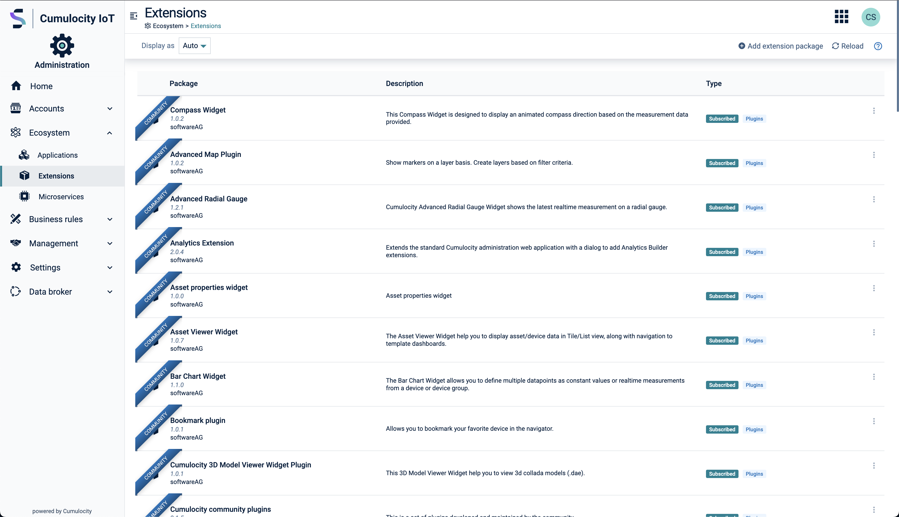

### Add the plugin to a standard application

1. Download `analytics-extension.zip` from the [releases](https://github.com/Cumulocity-IoT/cumulocity-analytics-management/releases).
2. In your tenant open Administration -> Ecosystem -> Extensions -> Add extension package and upload it.
3. Clone the standard application (e.g. Streaming Analytics, Cockpit) under Administration -> Ecosystem -> Applications -> Clone, if you have not done so yet.
4. Install the plugin in the cloned application.

The new application then appears in the app switcher.

## Build the plugin

**Prerequisites:** Git, Node.js (v18+ or v20+; release builds use `v18.19.0`) and npm.

**Main dependencies:** Angular 21, `@c8y/ngx-components` 1024.20, TypeScript 5.9, RxJS 7.8 (see [package.json](analytics-ui/package.json)).

Set the target tenant URL, username and password in your environment before starting.

```
git clone https://github.com/Cumulocity-IoT/cumulocity-analytics-management.git
cd cumulocity-analytics-management/analytics-ui
npm install
npm start          # optional: local development server
npm run build      # build the plugin
npm run deploy     # deploy to the tenant
npm run format     # optional: Prettier
npm run lint       # optional: ESLint with auto-fix
```

## Backend microservice

The microservice `analytics-ext-service` downloads the sample blocks from the configured repositories and builds an analytics extension as a zip file. You choose whether the extension is uploaded automatically or downloaded by the browser; a downloaded file has to be uploaded afterwards, see [Upload custom extension](#upload-custom-extension). The microservice is multi-tenant ready.

### Prerequisites to build and deploy
* Python 3.8+ 
* Docker host/client 
* [c8y-go-cli](https://goc8ycli.netlify.app) or c8y CLI

### Local debugging with VS Code / Dev Container
To run and debug the microservice locally you can use VS Code and the .devcontainer/devcontainer.json configuration. To test with real c8y microservice credentials create an .env-admin (Administrative Credentials to fetch BootStrap Credentials) file in the analytics service directory and start the container (F1 -> Open in Open Folder in container). The get_service_creds.py fetch the credentials and create the .env file containing the bootstrap credentials. 

To use your own credentials in the .env file comment the line `"postAttachCommand": "python3 .devcontainer/get_service_creds.py",` in devcontainer.json and create .env file with credentials of your liking. Env file format is:

* Example .env-admin
```
C8Y_BASEURL=https://<tenant>.cumulocity.com
C8Y_TENANT=<tenantId>
C8Y_USER=<user>
C8Y_PASSWORD=<password>
```

* Example .env
```
C8Y_BASEURL=https://<tenant>.eu-latest.cumulocity.com
C8Y_BOOTSTRAP_TENANT=<tenant_id>
C8Y_BOOTSTRAP_USER=servicebootstrap_analytics-ext-service
C8Y_BOOTSTRAP_PASSWORD=<password>
```

After the dev container has started you can debug flask-wrapper.py as a python file. 

To test the microservice you can issue the following curl command
```
curl --location 'http://127.0.0.1:<container host port>/extension' \
--header 'Content-Type: application/json' \
--header 'Authorization: Basic <tenant_id>/<username> as base64' \
--data '{
    "extension_name": "Test",
    "upload": true,
    "monitors": ["https://raw.githubusercontent.com/Cumulocity-IoT/apama-analytics-builder-block-sdk/rel/10.18.0.x/samples/blocks/CreateEvent.mon"]
}'
```

### Build and deploy

To build the backend as the microservice `analytics-ext-service`:
* run script: 
```
# cd analytics-service
# ./build.sh analytics-ext-service VERSION 
```
* upload the created image:
```
# c8y microservices list --name analytics-ext-service | c8y microservices createBinary --file dist/analytics-ext-service.zip --timeout 360
```
* or build and upload in one step with the active `c8y` session (the microservice must already exist):
```
# ./build.sh --push VERSION
```
> **NOTE**
For the first deployment create the microservice instead:
```
# c8y microservices create --file dist/analytics-ext-service.zip --name analytics-ext-service --timeout 360
```

## Analytics Builder block SDK

Custom blocks are developed with the [Analytics Builder block SDK](https://github.com/Cumulocity-IoT/apama-analytics-builder-block-sdk), which also documents how to write blocks. The release section includes an example block for testing; it adds two inputs.

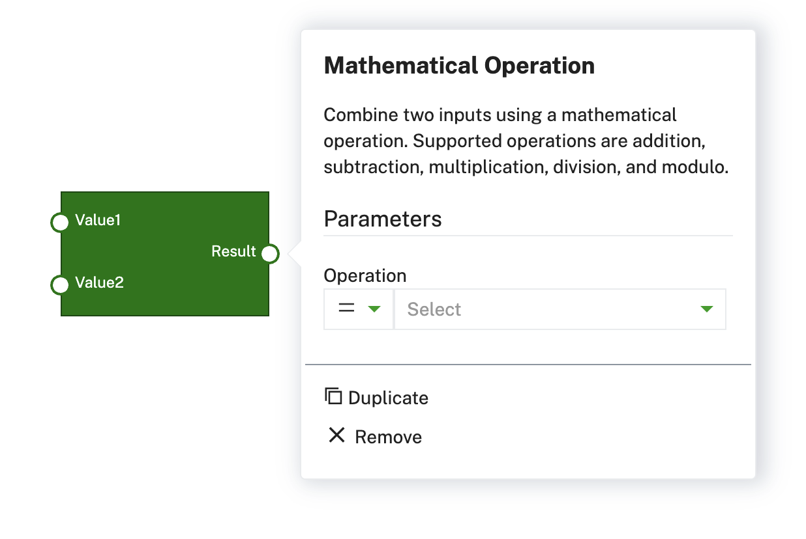


## Troubleshooting

* **Is an extension deployed?** Look for a message like the following in the analytics engine log (Administration -> Ecosystem -> Microservices -> apama-ctrl-1c-4g -> Logs):
  `[correlator]  2023-12-04 12:29:43.752 INFO [139659199286272] - Applying extension "/config/extensions/Sample_AB_Extension.zip"`
* **No extension is loaded after an upload:** the engine is probably in [safe mode](#safe-mode); delete the suspected extension and restart.
* **Repository list is empty with a 401 error:** configure a personal access token, see [Sample repositories](#sample-repositories-and-building-custom-extensions).
* **Cannot build extensions:** check that the backend microservice is deployed and the **Use backend service** switch is on, see [Monitoring](#backend-service-switch).


## Repository layout for building extensions

Two layouts were considered for building an extension from a GitHub repository folder:

1. Directory is Extension
This is the preferred because of its simplicity.

Mechanism: 
* The extension builder inspects the top-level items in the configured repository path.

* If an item is a .mon file (e.g., Difference.mon), a single-file extension is created from just that file.

* If an item is a directory (e.g., Python), an extension is created by packaging all the content within that directory (including subdirectories like venv).

User UI: 
* The user sees a list of names for each top-level .mon file and top-level directory (e.g., "Difference", "Offset", "Python"). Only one item (either directory or *.mon file) can be selected.

Key Benefit: Retains simple behavior for existing single-file blocks while easily supporting complex blocks that require multiple files and/or directories (like a Python environment).

2. Configuration File `extensions.yaml`
This layout uses a dedicated configuration file to define the extension's contents explicitly.

Mechanism: 
* The builder recursively inspects the directory for a specific configuration file `extensions.yaml`.

* If the file exists, the builder reads it for the extension's metadata and a list of files/contents to include. Multiple *.mon files can be selected.

* If no config file is present, it defaults to listing simple .mon files as before.

User UI: 
* If the config file is present, the UI should read it and only show the top-level keys defined in the file, not the embedded files or directories.

Key Benefit: Highly flexible, allowing for specifying dependent bundles and explicit control over included content. (However, this was abandoned in favor of the simpler Directory is Extension approach).


> **Note:** the solution was rebranded. Releases before 2.5.0 are still available in the [release section](https://github.com/Cumulocity-IoT/cumulocity-analytics-management/releases).

------------------------------

These tools are provided as-is and without warranty or support. They do not constitute part of the Cumulocity product. Users are free to use, fork and modify them, subject to the license agreement. While Cumulocity welcomes contributions, we cannot guarantee to include every contribution in the master project.
_____________________

For more information you can Ask a Question in the [techcommunity cumulocity](https://techcommunity.cumulocity.com/).
